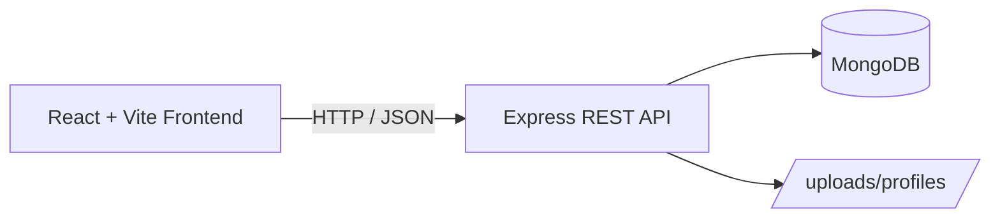

# Global Shipping

**Global Shipping** is a full-stack logistics management application for customers, shipping businesses, and administrators. It provides shipment booking and tracking, freight quotations, approved service listings, profile management, and role-based dashboards.

## Table of Contents

- [Overview](#overview)
- [Features](#features)
- [Technology Stack](#technology-stack)
- [Application Roles](#application-roles)
- [System Architecture](#system-architecture)
- [Project Structure](#project-structure)
- [Getting Started](#getting-started)
- [Environment Configuration](#environment-configuration)
- [Available Scripts](#available-scripts)
- [API Reference](#api-reference)
- [Data Models](#data-models)
- [Development Notes](#development-notes)
- [Known Limitations](#known-limitations)
- [Troubleshooting](#troubleshooting)
- [Contributing](#contributing)
- [License](#license)

## Overview

The application uses a React single-page frontend and a Node.js REST API backed by MongoDB. Users can register with one of three roles and are routed to a dedicated dashboard for their account type.



## Features

### Customer

- Create and sign in to a customer account
- View the dashboard and personal shipment activity
- Book air, sea, or road freight shipments
- Track shipments by tracking ID
- Request and review freight quotations
- Browse services that have been approved by an administrator
- Update profile details and upload a profile image

### Business

- View customer shipments and quotation requests
- Update shipment statuses
- Create logistics services
- Review business-specific services
- View estimated revenue and service activity
- Manage account and profile information

### Administrator

- View platform-wide dashboard statistics
- Create, update, and delete users
- Create and manage shipments
- Approve or reject quotation requests
- Approve or reject business services
- Manage platform pricing and settings views

## Technology Stack

| Layer | Technology |
| --- | --- |
| Frontend | React 19, React Router 7, Axios |
| Build Tool | Vite 8 |
| Styling | CSS |
| Backend | Node.js, Express 5 |
| Database | MongoDB with Mongoose 9 |
| File Uploads | Multer |
| Environment | dotenv |
| Frontend Linting | Oxlint |

## Application Roles

| Role | Primary Access |
| --- | --- |
| `customer` | Customer portal, bookings, tracking, quotes, approved services, and profile |
| `business` | Business dashboard, customer shipments, quotations, services, invoices, and profile |
| `admin` | Platform dashboard, user management, shipment management, quotes, and service approval |

The role is stored with the user and the frontend routes users to `/customer`, `/business`, or `/admin` after login.

## System Architecture

- `frontend/src/App.jsx` defines the application routes.
- Dashboard components handle role-specific client-side views.
- `backend/index.js` configures Express, CORS, JSON parsing, static uploads, MongoDB, and REST routes.
- MongoDB stores users, shipments, quotations, and business services.
- Profile photos are written to `backend/uploads/profiles/` and served through `/uploads`.

## Project Structure

```text
Global Shipping/
|-- backend/
|   |-- index.js              # Express server entry point
|   |-- models/               # Mongoose schemas
|   |-- routes/               # REST API route modules
|   |-- uploads/profiles/     # Uploaded profile images
|   `-- package.json
|-- frontend/
|   |-- public/               # Public static assets
|   |-- src/
|   |   |-- components/       # Role dashboards and shared UI
|   |   |-- assets/           # Images and frontend assets
|   |   |-- App.jsx           # Application routes
|   |   `-- main.jsx          # React entry point
|   `-- package.json
|-- .gitignore
`-- README.md
```

## Getting Started

### Prerequisites

- A Node.js release supported by Vite 8
- npm
- MongoDB 6 or newer, or a reachable MongoDB connection URI

### 1. Clone the Repository

```sh
git clone <repository-url>
cd "Global Shipping"
```

### 2. Start MongoDB

Start a local MongoDB instance, or prepare a hosted MongoDB connection URI.

For a default local setup, the application uses:

```text
mongodb://localhost:27017/globalshipp
```

### 3. Start the Backend

```sh
cd backend
npm install
node index.js
```

The API is available at `http://localhost:5000` by default. A health check is available at `http://localhost:5000/`.

### 4. Start the Frontend

Open a second terminal:

```sh
cd frontend
npm install
npm run dev
```

Vite will print the local development URL, normally `http://localhost:5173`.

The frontend currently sends API requests to `http://localhost:5000/api`.

## Environment Configuration

Create `backend/.env` to override backend defaults:

```dotenv
MONGO_URI=mongodb://localhost:27017/globalshipp
PORT=5000
```

| Variable | Required | Default | Description |
| --- | --- | --- | --- |
| `MONGO_URI` | No | `mongodb://localhost:27017/globalshipp` | MongoDB connection string |
| `PORT` | No | `5000` | Express server port |

> **Frontend configuration:** API URLs are currently defined directly in the React components and default to `http://localhost:5000/api`. Update the relevant API constants before deploying to a remote host.

## Available Scripts

### Frontend

Run these commands from `frontend/`:

| Command | Description |
| --- | --- |
| `npm run dev` | Start the Vite development server |
| `npm run build` | Create a production build in `frontend/dist` |
| `npm run preview` | Preview the production build locally |
| `npm run lint` | Run Oxlint |

### Backend

Run these commands from `backend/`:

| Command | Description |
| --- | --- |
| `node index.js` | Start the Express server |
| `npm test` | Placeholder only; no automated test suite is currently configured |

## API Reference

Base URL:

```text
http://localhost:5000/api
```

### Authentication

| Method | Endpoint | Description |
| --- | --- | --- |
| `POST` | `/auth/register` | Register a customer, business, or administrator |
| `POST` | `/auth/login` | Authenticate a user |

### Shipments

| Method | Endpoint | Description |
| --- | --- | --- |
| `GET` | `/shipments` | Get all shipments |
| `GET` | `/shipments/user/:userId` | Get shipments for a customer |
| `POST` | `/shipments` | Create a shipment |
| `PUT` | `/shipments/:id/status` | Update shipment status |

### Quotations

| Method | Endpoint | Description |
| --- | --- | --- |
| `GET` | `/quotes` | Get all quotations |
| `GET` | `/quotes/user/:userId` | Get quotations for a customer |
| `POST` | `/quotes` | Request a quotation |
| `PUT` | `/quotes/:id/status` | Approve or reject a quotation |

### Services

| Method | Endpoint | Description |
| --- | --- | --- |
| `GET` | `/services` | Get services; supports `status` and `businessId` query parameters |
| `POST` | `/services` | Create a business service |
| `PUT` | `/services/:id/status` | Approve or reject a service |

### Users

| Method | Endpoint | Description |
| --- | --- | --- |
| `GET` | `/users` | Get all users |
| `GET` | `/users/:id` | Get one user |
| `PUT` | `/users/:id` | Update a user's name, email, or role |
| `DELETE` | `/users/:id` | Delete a user |

### Profiles

| Method | Endpoint | Description |
| --- | --- | --- |
| `GET` | `/profile/:id` | Get a user profile |
| `PUT` | `/profile/:id` | Update name, phone, address, or company |
| `POST` | `/profile/:id/upload-image` | Upload a profile image using multipart form field `profileImage` |

## Data Models

### User

- Name, unique email, and password
- Role: `customer`, `business`, or `admin`
- Profile image, phone, address, and company
- Automatic creation and update timestamps

### Shipment

- Unique tracking ID
- Customer reference
- Origin, destination, freight type, weight, and dimensions
- Estimated cost and delivery date
- Status: `Booked`, `Packed`, `In Transit`, `Out for Delivery`, `Delivered`, or `Pending`

### Quote

- Customer reference
- Origin, destination, freight type, and weight
- Estimated cost and optional notes
- Status: `Pending`, `Approved`, or `Rejected`

### Service

- Name and description
- Price and business reference
- Status: `pending`, `approved`, or `rejected`

## Development Notes

- The frontend stores the signed-in user in browser `localStorage`.
- Profile images are statically exposed by the backend under `/uploads`.
- Shipment tracking IDs are generated in the format `GS` followed by nine random digits.
- Freight estimates are calculated by the backend from weight and freight type.
- Service listings are filtered by the `status=approved` query parameter for customers.
- The `.gitignore` excludes dependencies, environment files, build output, logs, and uploaded runtime files.

## Known Limitations

The current implementation is suitable for local development and demonstration, but the following items should be addressed before production use:

- Authentication is not JWT or session based.
- Passwords are stored and compared as plain text.
- API routes do not currently enforce server-side authorization middleware.
- Frontend API URLs are hardcoded to localhost.
- Automated tests and a CI/CD pipeline are not included.
- Profile image upload accepts a 50 MB maximum in the backend; the profile UI should show the same limit consistently.
- Invoices and pricing screens are currently dashboard views and are not backed by a complete billing workflow.

## Troubleshooting

### MongoDB Connection Errors

Confirm that MongoDB is running and that `MONGO_URI` in `backend/.env` is valid. Restart the backend after changing environment variables.

### Frontend Cannot Reach the API

Verify that the backend is running on port `5000` and that no firewall or proxy is blocking local requests.

### CORS or Invalid-Response Errors

Confirm that the frontend API host matches the Express server host and port, and inspect the backend terminal for route or database errors.

### Profile Image Upload Fails

Use an image format accepted by Multer (`jpg`, `jpeg`, `png`, `gif`, `webp`, `bmp`, or `svg`) and keep the file below the backend's 50 MB limit.

## Contributing

Contributions are welcome.

1. Fork the repository.
2. Create a focused feature branch:

   ```sh
   git checkout -b feature/your-feature-name
   ```

3. Make your changes and run the available checks:

   ```sh
   cd frontend
   npm run lint
   npm run build
   ```

4. Test the affected customer, business, and administrator flows where applicable.
5. Commit the changes and open a pull request with a clear description and screenshots for UI changes.

## License

No license is currently defined for this project. Add a `LICENSE` file if you intend to permit reuse or distribution.
